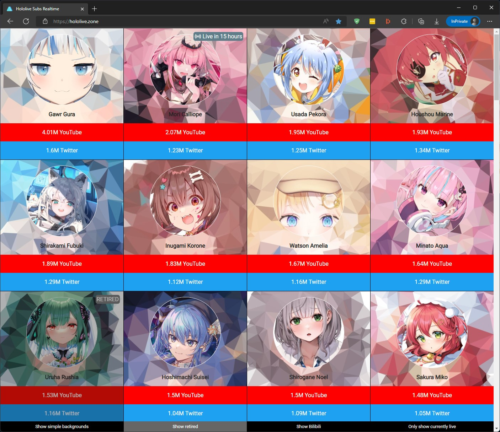

============
HololiveSubs
============

Website which tracks the YouTube and Bilibili subscriber counts of all Hololive talents, orders them by
YouTube subscribers and shows who is live or about to go live.

https://holo.naa.gg/

How it works
============

``holozone.py`` is the whole backend: one Python process that serves the site and refreshes the data in a
background thread.

- Every 30 min: subscriber counts and avatars (YouTube Data API, Bilibili).
- Every 15 min: live and upcoming streams (read from each channel's ``/live`` page).
- After each run it writes ``stats.json``, per-talent calendars (``/events/<handle>.ics``), RSS feeds
  (``/rss/<handle>.xml``) and a daily snapshot (``/archive/stats-YYYY-MM-DD.json``) into ``DATA_DIR``.

The talent list lives in ``talents.json``.

Running
=======

.. code-block:: sh

  YOUTUBE_KEY=... uv run holozone.py   # http://localhost:8080

Or with Docker (``ghcr.io/nachtalb/hololivesubs``), see ``docker-compose.yml``.

Environment: ``YOUTUBE_KEY`` (required), ``DATA_DIR`` (default ``./data``), ``PORT`` (default ``8080``),
``SITE_URL`` (used in feeds and calendars, default ``https://holo.naa.gg``).

Tests: ``uv run --with pytest pytest``.
